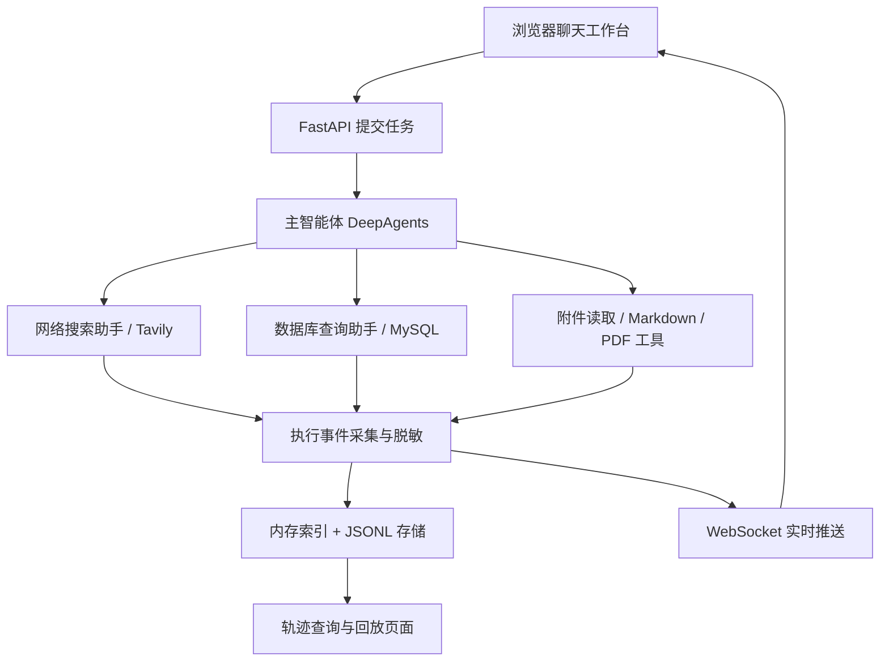

# DeepSearchAgent

多智能体研究与报告生成助手：通过自然语言调度网络搜索、内部数据库查询和文件读取，生成 Markdown / PDF 报告，并在浏览器中查看执行进度与调用轨迹。

这是一个从命令行工具调用逐步搭建到 Web 应用的学习实践项目，参考了 [Deep Search Pro](https://github.com/waseens/deep-search-pro) 的设计思路。仓库保留了阶段性实验代码，便于理解多智能体编排、异步服务、会话隔离和执行过程追踪。

## 已实现功能

| 能力 | 实现说明 |
| --- | --- |
| 多智能体编排 | 基于 DeepAgents，主智能体按需委派网络搜索、数据库查询子智能体 |
| 网络搜索 | 使用 Tavily 搜索公开信息；未配置密钥时跳过注册搜索助手 |
| 数据库问答 | 探索 MySQL 表结构、预览数据、执行查询并总结结果；提供演示数据与只读账号配置脚本 |
| 文件读取 | 支持文本、Markdown、CSV、JSON、DOCX、PDF、XLSX 等文件，限制返回文本长度 |
| 报告生成 | 生成 Markdown；在 Windows + Microsoft Word 环境下转换为 PDF |
| Web 工作台 | 原生 HTML / CSS / JavaScript 聊天页和轨迹页，无需前端构建 |
| 实时进度 | FastAPI 后台执行任务，WebSocket 推送执行事件 |
| 轨迹回放 | 按事件序号补取断线期间的事件；轨迹写入 JSONL，启动时加载历史记录 |
| 会话隔离 | ContextVar 传递会话上下文，文件路径在会话目录内解析与校验 |
| 配置与降级 | 启动时检查模型配置；搜索和数据库能力按配置启用 |

> 轨迹回放恢复的是历史事件展示，不等同于服务器重启后自动续跑未完成的 Agent 任务。

## 架构与执行流程



- `thread_id` 标识会话；同一会话可以有多次任务执行。
- `run_id` 标识一次任务执行，用于关联轨迹记录。
- `sequence` 是事件序号，用于增量查询与断线补取。
- 智能体会话状态使用 `InMemorySaver`，执行轨迹使用 JSONL；两者用途和持久化范围不同。

## 技术栈

Python、LangChain、LangGraph、DeepAgents、FastAPI、Pydantic、asyncio、WebSocket、Tavily、MySQL、pytest，以及原生 HTML / CSS / JavaScript。

当前锁定的主要版本：`deepagents==0.4.3`、`langchain==1.2.10`、`langgraph==1.0.9`、`fastapi==0.129.2`。完整依赖见 [requirements.txt](requirements.txt)。依赖清单包含学习期间安装的扩展包，不代表所有包都已接入业务流程。

## 快速开始（Windows PowerShell）

### 1. 准备环境

当前完整依赖清单包含 Windows 专用的 `pywin32`，以下步骤面向 Windows，建议使用 Python 3.13。模型调用需要支持工具调用的 OpenAI 兼容服务及有效 API Key。

```powershell
git clone https://github.com/zhuwenxi317/DeepSearchAgent.git
cd DeepSearchAgent
py -3.13 -m venv .venv
.\.venv\Scripts\python.exe -m pip install --upgrade pip
.\.venv\Scripts\python.exe -m pip install -r requirements.txt
```

命令直接使用虚拟环境解释器，不需要先激活环境。PDF 导出额外依赖本机安装的 Microsoft Word；仅生成 Markdown 不需要 Word。

### 2. 配置模型

```powershell
Copy-Item .env.example .env
```

编辑 `.env`，填入你自己的配置。例如使用 DeepSeek 兼容接口：

```dotenv
LLM_QWEN_MAX=deepseek-chat
OPENAI_BASE_URL=https://api.deepseek.com
OPENAI_API_KEY=填写你自己的模型密钥
```

`LLM_QWEN_MAX` 是当前代码沿用的配置变量名，不限制只能使用 Qwen；值应为服务商实际提供的模型名称。`.env` 已被 Git 忽略，不要提交真实密钥。

可选能力：

| 配置项 | 用途 |
| --- | --- |
| `TAVILY_API_KEY` | 配置后启用网络搜索助手 |
| `MYSQL_HOST` / `MYSQL_PORT` | MySQL 地址与端口，默认 localhost / 3306 |
| `MYSQL_USER` / `MYSQL_PASSWORD` / `MYSQL_DATABASE` | 三项齐全时注册数据库查询助手 |

仅配置模型即可启动基础对话、文件和报告流程；联网检索与数据库问答需要分别配置对应服务。

### 3. 启动服务

```powershell
$env:PYTHONIOENCODING = "utf-8"
.\.venv\Scripts\python.exe api/server.py
```

启动后访问：

- 聊天工作台：http://127.0.0.1:8000/
- 执行轨迹页：http://127.0.0.1:8000/trace
- API 文档：http://127.0.0.1:8000/docs

可以尝试：

- 配置搜索后：`搜索多智能体系统的应用案例，整理来源并生成 Markdown 报告。`
- 上传文件后：`读取我上传的文档，总结主要内容。`
- 配置演示数据库后：`查询各仓库的库存情况，并按产品汇总。`
- 已生成 Markdown 且安装 Word 后：`将刚才的报告转换为 PDF。`

## 可选：初始化 MySQL 演示数据

需要先安装并启动本地 MySQL，在 `.env` 中暂时配置具有建库建表权限的管理员账号，并设置 `MYSQL_DATABASE=deep_search_demo`。

```powershell
.\.venv\Scripts\python.exe test/db_connection_test.py
.\.venv\Scripts\python.exe database/init_demo_data.py
.\.venv\Scripts\python.exe database/create_readonly_user.py
```

注意：

- 初始化脚本会重建目标库中的 `warehouses`、`products`、`inventory`、`sales_records` 四张演示表，请只对专用演示库执行。
- 只读账号脚本面向本地演示环境，为 `deepsearch@localhost` 授予目标库的 SELECT 权限，并更新本地 `.env` 的数据库账号和密码。
- 工具层还提供 SQL 检查、查询超时设置与结果截断，但数据库账号的最小权限仍是必要边界。

## 目录结构

```text
agent/       模型配置、主智能体与子智能体
api/         FastAPI、会话上下文、WebSocket 和轨迹系统
prompt/      YAML 提示词配置
tools/       搜索、数据库、文件读取与报告工具
utils/       路径校验和 Word/PDF 转换
database/    演示数据和数据库初始化脚本
web/         聊天工作台与轨迹页面
tests/       pytest 自动化测试
test/        按里程碑组织的实验及手动集成验证脚本
output/      会话文件目录（运行时生成，不提交）
data/traces/ JSONL 执行轨迹（运行时生成，不提交）
```

## 主要接口

| 接口 | 用途 |
| --- | --- |
| `POST /api/task` | 提交任务，返回会话与执行标识 |
| `POST /api/upload` | 上传会话附件 |
| `GET /api/files` | 列出会话文件 |
| `GET /api/download` | 下载会话文件 |
| `GET /api/threads/{thread_id}/runs` | 查询会话执行记录 |
| `GET /api/runs/{run_id}/trace` | 查询轨迹，支持 `after_sequence` 增量读取 |
| `WS /ws/{thread_id}` | 接收执行事件与重连补取 |

参数定义以运行后的 `/docs` 和 [api/server.py](api/server.py) 为准。

## 测试

```powershell
.\.venv\Scripts\python.exe -m pip install pytest pytest-asyncio
.\.venv\Scripts\python.exe -m pytest -q
```

`pytest.ini` 默认只收集 `tests/`，覆盖配置降级、数据库工具、路径边界、事件脱敏和轨迹存储。当前版本本地验证 **44 项通过**。这些测试不等于对所有模型服务、MySQL 实例和 Word 安装环境做过端到端验证。

`test/` 中是阶段性学习实验，部分脚本需要运行中的服务或外部 API，应按脚本说明单独执行。

## 当前边界与后续计划

- 当前以单机、单进程运行和学习演示为目标；尚未提供用户登录与完整权限管理，不建议直接暴露到公网。
- Agent checkpoint 保存在内存中，服务重启会丢失该状态；JSONL 持久化仅用于执行轨迹。
- PDF 导出依赖 Windows Word COM；其他平台需要替换转换实现并调整依赖。
- 文件读取目前是文本提取，不等同于文档向量化和 RAG 知识库检索。
- 后续计划：RAG 检索与引用、人工审批（Human-in-the-loop）、持久化 checkpoint、更完善的端到端评测。
